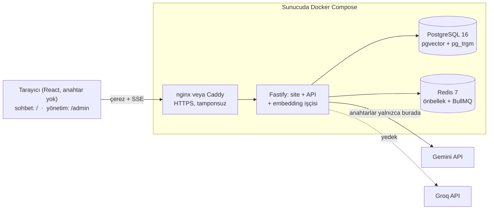

# Menü Kopilot

Bir yemek sipariş platformunda restoran şubesi açan müşteri temsilcisinin, restoranla telefonda konuşurken kullandığı web sitesi.
Restoran yalnızca menüsüyle gelir; site menüyü okur ve görüşmeyi yönetir:

- **Ekran görüntüsünü Ctrl+V ile yapıştır** (sayfanın herhangi bir yerinde), sürükle-bırak yap ya da ürünleri yaz. Aynı
  panelin birden fazla ekran görüntüsü tekrarsız birleştirilir.
- **İlk cevap**, menünün durumunu (`7 ürün, hedef 20`), önce neyin teklif edileceğini ve sıradaki adımları gösterir.
  Menüyü hedefin biraz ötesine taşıyacak kadar yeni ürün önerir; tek bir ürün yazılsa bile ("hamsi") önce o ürünün
  çeşitleri, sonra aynı türden ürünler, sonra mutfağın geri kalanı gelir.
  Altında üç sekmede kartlar vardır:
  **Yeni ürünler** (menüde olmayan ve bu mutfağın yapabileceği ürünler, restorana söylenecek cümleyle birlikte),
  **Opsiyon ve malzeme** (menüdeki her ürün için opsiyon grupları, çıkarılabilir ve ekstra malzemeler, açıklama),
  **Düzeltmeler** (yanlış yazılmış ad, yanlış başlıkta duran ürün).
- **Sohbet gibi çalışır.** "Tatlı öner", "Adana için opsiyon yaz", "ayran yokmuş", "restoran dürüm istemiyor, ne
  diyeyim?" ya da ikinci bir ekran görüntüsü: her takip mesajı ilk analizle aynı ajanlardan ve kontrollerden geçer, aynı
  görüşmede hiçbir ürün iki kez önerilmez.
- **Her şey tek kopyayla panele hazır:** bir kart, kartın bir satırı ya da bütün sekme düz metin olarak kopyalanır.

Sitede hesap ve şifre yoktur: tarayıcının ilk mesajı bir ziyaretçi oluşturur, görüşmeleri bir çerez tutar. `/admin`
adresindeki yönetim panelinin gerçek bir girişi vardır.

> **Karar desteğidir, otorite değil.** Öneriler şablonlardan ve yapay zekâdan gelir, restoranla teyit edilmelidir. Site
> hiçbir sipariş platformuna bağlanmaz: giriş elle yapılır (yazı, ekran görüntüsü), çıkış kopyala-yapıştırdır.
> **Şablonlarda fiyat olmaz.** Sitenin gösterdiği tek tutar yeni ürünün *tahmini* fiyat aralığıdır (`25–40 TL`); bu yalnızca
> konuşmayı açmak içindir, şablon havuzuna yazılmaz. Fotoğraftan okunan fiyatlar hiçbir ürüne atanmaz.

## İçindekiler

1. [Hızlı başlangıç](#hızlı-başlangıç)
2. [Mimari](#mimari)
3. [Proje yapısı: neyi nerede değiştiririm?](#proje-yapısı-neyi-nerede-değiştiririm)
4. [Sık yapılan işler](#sık-yapılan-işler)
5. [Çalışma kuralları](#çalışma-kuralları)
6. [Ortam değişkenleri](#ortam-değişkenleri)
7. [API özeti](#api-özeti)
8. [Testler](#testler)
9. [Canlıya alma](#canlıya-alma)
10. [Güvenlik ve gizlilik](#güvenlik-ve-gizlilik)
11. [Sorun giderme](#sorun-giderme)
12. [Belgeler](#belgeler)
13. [Lisans](#lisans)

## Hızlı başlangıç

Gerekenler: **Node.js 22+**, **pnpm 11** (`corepack enable` yeterli, sürüm `package.json` içinde sabit), **Docker Desktop**,
git. Komutlar PowerShell içindir; macOS/Linux'ta `Copy-Item` yerine `cp` kullan.

```powershell
git clone git@github.com:bcsakalar/Menu_Kopilot.git
cd Menu_Kopilot
Copy-Item .env.example .env
```

`.env` içine kendi `GEMINI_API_KEY` ve `GROQ_API_KEY` anahtarlarını yaz (nereden alınacağı aşağıda). Anahtarsız da çalışır:
yazılan ürün listeleri hazır şablon havuzundan cevaplanır, yalnızca ekran görüntüsü okunamaz. Canlının anahtarlarını
kullanma, kendine ait anahtar aç.

### Seçenek A: her şey Docker'da (en hızlısı)

```powershell
docker compose up -d --build
```

- Site: http://localhost:3000 · Yönetim: http://localhost:3000/admin
- İlk açılışta veritabanı tabloları ve tohum veriler (26 mutfak, 966 şablon) kendiliğinden kurulur.
- Yönetim girişi `.env` içindeki `ADMIN_EMAIL` ve `ADMIN_PASSWORD`. Şifreyi boş bırakırsan geliştirmede `change-me-now`
  olur (e-posta boşsa `admin@menukopilot.local`).

### Seçenek B: anlık yenilemeyle geliştirme (günlük çalışma için)

Veritabanı ve Redis Docker'da, kod senin makinende çalışır; kaydettiğin anda yenilenir.

```powershell
docker compose up -d postgres redis

cd backend
pnpm install
pnpm db:migrate
pnpm db:seed
pnpm dev            # API: http://localhost:3000
```

Ayrı bir terminalde:

```powershell
cd web
pnpm install
pnpm dev            # Site: http://localhost:5173 (/api isteklerini 3000'e yönlendirir, çerezler canlıdaki gibi çalışır)
```

İlk denemede http://localhost:5173 adresine gir, örnek düğmelerinden birine tıkla ya da bir menü ekran görüntüsü yapıştır.

### API anahtarları

- **Gemini:** [Google AI Studio → API keys](https://aistudio.google.com/apikey) → *Create API key* → `GEMINI_API_KEY`.
- **Groq:** [Groq Console → API Keys](https://console.groq.com/keys) → *Create API Key* → `GROQ_API_KEY`.
- Anahtarları denemek için (gerçek istek atar): `cd backend; pnpm test:smoke`. Normal testler anahtar istemez.

## Mimari



**Bir mesajın yolculuğu** (`backend/src/modules/chat/service.ts`):

1. Mesajda görüntü varsa ya da ilk mesaj bir ürün listesiyse **analiz** başlar.
2. Diğer mesajlarda önce **sohbet ajanı** (`agents/chat.ts`) karar verir: doğrudan cevap mı, yoksa analizin bir parçasını
   mı çalıştırmalı (bir kategoriden ürün, belirli ürünlere opsiyon, menü güncellemesi, mutfak değişimi). Sohbet ajanı ürün
   yazmaz; ürünler her zaman aşağıdaki ajanlardan ve kontrollerden geçer. "Çorba öner" gibi hazır düğmeler modele hiç
   sorulmaz.
3. Analiz altı adımlık bir hattır (`agents/pipeline.ts`):

   | Adım | Dosya | Ne yapar |
   |---|---|---|
   | Menü okuma | `extractor.ts` | Görüntülerden ürünleri okur, tekrarları birleştirir (görsel model) |
   | Mutfak türü | `classifier.ts` | Önce havuz oylar: ürünlerin çoğu bir mutfağın havuzundaysa model sorulmaz; belirsizse ucuz model karar verir (D-217) |
   | Eksik analizi | `gap-analyst.ts` | Mutfağın kategori beklentisine göre eksikleri sayar (model yok) |
   | Yeni ürün | `product-recommender.ts` | Menüde olmayan, bu mutfağın yapabileceği ürünler (önce havuz, sonra model) |
   | Opsiyon ve malzeme | `option-modifier.ts` | Menüdeki ürünlere opsiyon, çıkarılabilir, ekstra, açıklama |
   | Doğrulama | `validator.ts` | Her cevabı kodla kontrol eder: şema, tekrar, mutfağa uygunluk, kota |

   4 ve 5 paralel çalışır. Bir adım hata verirse analiz durmaz, elindekiyle devam eder.

**Havuz ve model birlikte (D-217):** havuz yapabildiğini yapar, model havuzun yapamadığını. Menüsüz bir mutfak
başlangıcında önce o mutfağın kendi ürünleri gelir; açık kategoriler bitince mutfağın diğer kategorilerinden doldurulur.
Yalnızca bir mutfak adı ve istek içeren mesaj ("Tantuni için öneri sun") modele sorulmadan o mutfaktan başlar. Modelin
yazdığı ve kontrolden geçen her yeni ürün havuza **onay bekleyen öneri** olarak girer; tekrar önerildikçe sayacı artar.
Yönetimde Şablon havuzu → Yapay zekâ önerileri sekmesinden tek tıkla havuza alınır, silinen arşive düşer ve bir daha aday
olmaz. Onaylanmamış öneri temsilciye hiç sunulmaz. Havuzun tek başına ne verdiğini `pnpm probe:pool` ölçer.

**Token ekonomisi:** önce veritabanı ve önbellek cevap verir, model son çaredir.

- **Havuz:** tam ad → takma ad → `pg_trgm` benzerliği → pgvector. Hazır şablonlar ve onaylı ürünler modelsiz gelir.
- **Önbellek (Redis, 30 gün):** aynı görüntü ya da aynı menü ikinci kez para harcatmaz.
- **Bütçe:** analiz başına sınırlı çağrı ve token, ziyaretçi başına ve site geneli günlük kota. Süre dolarsa kalan bölümler
  havuzdan doldurulur.
- **Model yönlendirici** (`ai/router.ts`): her görev için yedekli bir zincir (önce Gemini, sonra Groq), devre kesici,
  hız limiti bekleme süreleri. Promptlar veritabanında sürümlenir.

**Kitchen profile** (`agents/kitchen.ts`): menüdeki ürünlerden mutfağın neyi yapabildiğini çıkarır. Kokoreççiye waffle,
dönerci olmayana döner önerilmesini bu engeller.

**Araçlar (D-218):** sol üstteki "Asistan | Araçlar" geçişi `/araclar` sayfasını açar. Asistan olduğu gibi kalır. Araçlar
tarayıcıda çalışır, metin ve dosyalar sunucuya gitmez; yapay zekâ kullanılmaz.

- **Metin düzeltme:** ürün/mağaza adı ve açıklama, panelin yazım kurallarına göre yazdıkça düzeltilir. Yapıştırılan
  metnin düzeltilmiş hâli panoya kopyalanır; "Otomatik pano" açıksa başka yerde kopyalanan metin sekmeye dönünce
  düzeltilip panoya geri yazılır. Türkçe karakter tamamlama, yazım hatası ve bitişik kelime düzeltmesi
  şablon havuzundan çıkan sözlükle yapılır (`GET /api/v1/tools/lexicon`, açık, yalnızca okuma).
- **Excel:** .xlsx ya da .csv açılır; arama, sıralama, sayfa sekmeleri. Ad ve açıklama sütunları kurallarla düzeltilip
  .xlsx olarak indirilir.
- **Logo ve banner:** ürün görseli (1000 × 1000), mağaza logosu (500 × 500) ve banner (1035 × 390), en fazla 150 KB;
  kırp ya da sığdır, JPEG ya da PNG.

## Proje yapısı: neyi nerede değiştiririm?

| Klasör | İçerik |
|---|---|
| `backend/` | Node.js 22 + TypeScript (strict) + Fastify 5, Drizzle ORM, PostgreSQL + pgvector, Redis + BullMQ, Zod |
| `web/` | React 19 + Vite + TypeScript, düz CSS. Üretimde API imajının içine gömülür ve Fastify tarafından sunulur |
| `deploy/` | Üretim compose dosyası, paylaşılan sunucu için nginx ayarı, boş sunucu için `Caddyfile`, yedek betiği |
| `scripts/` | Anahtar taraması, deploy betiği (imajı bilgisayarda kurar, ssh ile kopyalar), yerel başlatma |
| `docs/` | Deploy kılavuzu, SSE sözleşmesi, sağlayıcı notları, yapay zekâ ölçüm raporları, arşiv |
| `tests/ai_eval/` | 27 mutfak üzerinde öneri kalitesini ölçen bağımsız düzenek |

| Değiştirmek istediğin | Dosya |
|---|---|
| Sohbet ekranı | `web/src/chat/ChatApp.tsx` (sayfa), `RunBlock.tsx` (kartlar), `Composer.tsx` (yapıştırma, mesaj kutusu) |
| Yönetim paneli | `web/src/admin/AdminApp.tsx` (menü, giriş), `pages.tsx` (sayfalar) |
| Renkler, yazı, boşluklar | `web/src/styles.css` (bütün renkler en üstteki değişkenlerde; tasarım kuralları `DESIGN.md`) |
| Panele kopyalanan metin | `web/src/format.ts` |
| Bir mesajın işlenişi | `backend/src/modules/chat/service.ts`, sabit metinler `summary.ts` |
| Ajanlar ve analiz hattı | `backend/src/agents/` |
| Modellere giden metinler (prompt) | `backend/src/agents/prompts/*.ts`, sürümler `prompts/index.ts` |
| Model, zincir, zaman aşımı | `backend/src/config/models.ts` |
| Ortam değişkenleri | `backend/src/config/env.ts` (tek okuma yeri) ve `.env.example` |
| Veritabanı tabloları | `backend/src/db/schema/*.ts`, migration'lar `backend/drizzle/` |
| Mutfaklar, kategoriler, hazır şablonlar | `backend/src/db/seed/` (`cuisines.ts`, `categories.ts`, `templates-*.ts`, `product-types.ts`) |
| Giriş ve çerezler | `backend/src/plugins/auth.ts`, `backend/src/modules/auth/` |
| Rotaların bağlandığı yer | `backend/src/app.ts` (açık sohbet / oturum / yalnızca admin olarak üç kapsam) |
| Yük: kuyruk, hız sınırları, uyarılar | `backend/src/lib/slots.ts`, `lib/visitor-limits.ts`, `modules/admin/load.ts`; ölçüm `pnpm probe:load` (D-214, D-215) |
| Araçlar: yazım kuralları, Excel, görsel | `web/src/tools/` (kurallar `text/format.ts`, sözlük `text/lexicon.ts`, testler `*.test.ts`); sözlük ucu `backend/src/modules/tools/` (D-218) |
| Havuzun modelsiz cevabı, yapay zekâ önerileri | `agents/product-recommender.ts`, `agents/classifier.ts`, `modules/templates/template-store.ts` (`recordDrafts`); ölçüm `pnpm probe:pool` (D-217) |

## Sık yapılan işler

### Arayüzde bir değişiklik

Seçenek B ile çalış, `web/src` altında değiştir, tarayıcı anında yenilenir. Bitince `cd web; pnpm test; pnpm build`.

### Bir prompt'u değiştirmek

1. `backend/src/agents/prompts/` altındaki dosyada metni değiştir.
2. `backend/src/agents/prompts/index.ts` içindeki `AGENT_PROMPT_VERSIONS` tablosunda o anahtarın numarasını bir artır ve
   yanına tek satır not düş.
3. Sunucu açılırken tohumlama yeni sürümü ekler ve etkinleştirir. Sürüm önbellek anahtarına girdiği için eski cevaplar
   kullanılmaz.

Sürümü artırmazsan değişiklik canlıya **yansımaz**, çünkü veritabanında aynı numaralı eski metin durur.

### Modeli ya da zinciri değiştirmek

- Bir görevin birincil modelini anlık değiştirmek: yönetim paneli → **Modeller**.
- Kalıcı varsayılan: `backend/src/config/models.ts` içindeki `DEFAULT_ROUTES`. Bu yalnızca boş veritabanını etkiler; var
  olan veritabanındaki sırayı değiştirmek için `0007_web_chat.sql` gibi bir migration yaz.

### Veritabanı şemasını değiştirmek

0003'ten beri migration'lar elle yazılıyor:

1. `backend/src/db/schema/` altında tabloyu değiştir.
2. `backend/drizzle/000N_ad.sql` (ileri) ve `backend/drizzle/down/000N_ad.sql` (geri) dosyalarını yaz.
3. `backend/drizzle/meta/_journal.json` sonuna kaydı ekle.
4. `backend/test/integration/migrations.test.ts` içindeki tablo sayılarını ve geri alma sırasını güncelle.
5. `pnpm test` ileri → geri → ileri döngüsünü dener. Migration'lar sunucu açılırken kendiliğinden uygulanır.

### Mutfak, kategori ya da hazır şablon eklemek

- Elle ve anında: yönetim paneli → **Mutfak türleri** (hedef ürün sayısı, kategori minimumları) ve **Şablon havuzu**.
- Toplu, Excel ile: **Şablon havuzu → Örnek Excel**'i indir, doldur (Google Sheets'te de açılır), **Excel'den yükle**.
  Önce önizleme gelir; aynı mutfakta aynı isimli ürün güncellenir, yoksa eklenir. **Havuzu Excel'e aktar** aynı düzende
  dışa aktarır: düzenleyip geri yüklemek toplu güncellemedir (`backend/src/modules/templates/excel.ts`).
- Kodla, herkes için: `backend/src/db/seed/` dosyaları. Tohumlama her açılışta çalışır ama panelden düzenlenmiş ya da
  silinmiş kayıtların üzerine yazmaz.

### Yeni bir API ucu

Mevcut modüllerin düzenini izle: `backend/src/modules/<ad>/` altında `schemas.ts` (Zod), `service.ts`, `routes.ts`.
Rotayı `app.ts` içinde doğru kapsama bağla: ziyaretçiye açık mı, oturum mu istiyor, yalnızca admin mi? Ziyaretçinin ortak
veriye yazabildiği bir uç açma.

### Test yazmak

`backend/test/helpers/test-app.ts` içindeki `createTestApp`, gerçek veritabanı yerine PGlite, gerçek model yerine
`FakeProvider` kullanır; Docker ve anahtar gerekmez. Sohbet akışına örnek: `backend/test/e2e/chat.e2e.test.ts`.

## Çalışma kuralları

- **Göndermeden önce** (CI de aynısını yapar):
  - `cd backend; pnpm lint; pnpm typecheck; pnpm test`
  - `cd web; pnpm test; pnpm build`
- **Anahtarlar yalnızca sunucuda.** `web/` altındaki her şey herkese açık pakete girer. `scripts/check-no-provider-keys.ps1`
  bunu kontrol eder. `.env` ve `.env.production` asla commit edilmez.
- **Prompt değişince sürüm artar**, **migration'ın geri dosyası olur.**
- **Arayüz metinleri Türkçe**; kod, kod yorumları ve commit mesajları İngilizce (mevcut düzen).
- **Commit mesajları** kısa ve kapsamlı: `feat(web): …`, `fix(api): …`, `docs: …`.
- **Önemli kararlar** `DECISIONS.md` sonuna `D-220`'den devam ederek yazılır: ne karar verildi, neden.
- **Canlıya alma** sunucu erişimi isteyen bir iştir; proje sahibiyle konuşmadan yapılmaz.

## Ortam değişkenleri

Hepsi [`.env.example`](.env.example) içindedir. Bir test bu dosyanın `backend/src/config/env.ts` ile aynı kalmasını
denetler.

| Değişken | Varsayılan | Anlamı |
|---|---|---|
| `NODE_ENV` | `development` | `production` zayıf sırlarla açılmayı reddeder ve çerezleri `Secure` yapar |
| `HOST`, `PORT` | `0.0.0.0`, `3000` | HTTP dinleyicisi |
| `LOG_LEVEL` | `info` | pino seviyesi |
| `TRUST_PROXY` | `true` | Proxy'den gelen `X-Forwarded-*` başlıklarına güven |
| `ROLE` | `all` | `api`, `worker` ya da `all` (API ve embedding işçisi tek süreçte) |
| `DATABASE_URL` / `REDIS_URL` | yerel adresler | compose bunları kendi servis adlarıyla değiştirir |
| `POSTGRES_USER` / `POSTGRES_PASSWORD` / `POSTGRES_DB` | `menu` / `menu` / `menu_kopilot` | veritabanı konteyneri |
| `JWT_SECRET` | — | en az 32 rastgele karakter, üretimde zorunlu |
| `JWT_ACCESS_TTL` | `12h` | admin oturumunun süresi (ziyaretçi çerezi bir yıl yaşar) |
| `ADMIN_EMAIL` / `ADMIN_PASSWORD` / `ADMIN_NAME` | — | yönetim paneli hesabı, tohumlama oluşturur |
| `SEED_ON_START` | `true` | açılışta migration ve tohumlamayı çalıştır |
| `GEMINI_API_KEY`, `GROQ_API_KEY` | — | sağlayıcı anahtarları; eksik olan zincirden düşer |
| `LOCAL_ONLY_MODE` | `false` | hiçbir dış API'ye gitme, yalnızca havuz ve önbellek |
| `DAILY_LLM_CALL_QUOTA`, `DAILY_TOKEN_QUOTA` | `1000`, `5000000` | ziyaretçi başına günlük kota; yalnızca sağlayıcının işlediği çağrılar sayılır (D-216) |
| `GLOBAL_DAILY_LLM_CALL_QUOTA` | `10000` | site geneli günlük tavan (çerezi silmek bunu sıfırlamaz); %80'inde ntfy uyarısı (D-216) |
| `QUOTA_TIMEZONE` | `Europe/Istanbul` | "günün" başladığı saat dilimi |
| `REQUEST_MAX_LLM_CALLS`, `REQUEST_MAX_INPUT_TOKENS` | `6`, `25000` | analiz başına bütçe; her görüntü bir çağrı ve 4000 token ekler |
| `RETRIEVAL_TRGM_THRESHOLD`, `RETRIEVAL_VECTOR_THRESHOLD` | `0.72`, `0.85` | havuz eşleşme eşikleri |
| `CACHE_TTL_DAYS` | `30` | Redis önbellek süresi |
| `UPLOAD_MAX_FILES`, `UPLOAD_MAX_FILE_MB` | `5`, `8` | mesaj başına görüntü sınırları |
| `ANALYSIS_CONCURRENCY`, `ANALYSIS_QUEUE_MAX` | `10`, `50` | aynı anda çalışan analiz; fazlası sırasını görerek bekler, sıra doluysa "çok yoğunuz" (D-214) |
| `ALERT_NTFY_URL` | — | yük uyarıları için ntfy konu adresi: yavaş analiz, başarısız sağlayıcı, dolu kuyruk (D-214) |
| `API_PORT` | `3000` (üretim `3030`) | compose'un API'yi yalnızca `127.0.0.1` üzerinde açtığı port |
| `SITE_ADDRESS` | `:80` | Caddy için alan adı (boş sunucuda otomatik HTTPS) |

## API özeti

Hepsi `/api/v1` altındadır. Sohbet uçları açıktır ve ziyaretçi çereziyle tanınır; geri kalanı admin çerezi ya da
`Authorization: Bearer <token>` ister. Hatalar hep `{ "error": { "code", "message", "details?", "requestId" } }`
biçimindedir. Etkileşimli belge `/docs` adresindedir (canlıda kapalı).

| Alan | Uçlar |
|---|---|
| Sohbet (açık) | `POST /chat/messages` (multipart: `conversationId?`, `text?`, `images[]` ≤ 5; cevap SSE ile akar), `GET /chat/conversations`, `GET/DELETE /chat/conversations/:id` |
| Yönetim | `GET /admin/overview?range=today\|week\|month`, `GET /admin/conversations`, `GET /admin/conversations/:id`, `GET /admin/feedback`, `PATCH /admin/feedback/:id` |
| Geri bildirim (açık) | `POST /feedback` (`kind`, `message`, `name?`, `conversationId?`; dakikada 5) |
| Giriş | `POST /auth/login` (admin çerezini koyar), `POST /auth/logout`, `GET /auth/me` |
| Analiz | `GET /analyze/:runId`, `/events`, `/trace`, `POST /analyze/:runId/cancel` (oturum sahibi); `POST /analyze` ve `POST /suggestion-items/:id/accept\|skip\|later` yalnızca admin |
| Kategoriler | `GET /categories`, `PATCH /categories/:key`, `GET/PUT /cuisines/:id/categories` |
| Şablon havuzu | `GET /templates`, `GET/PATCH/DELETE /templates/:id`, `POST /templates`, `GET /templates/excel/sample`, `GET /templates/excel/export`, `POST /templates/excel/import?dryRun=true\|false` |
| Ayarlar | `GET/POST/PATCH/DELETE /cuisines`, `GET /settings/providers`, `PUT /settings/providers/:taskKey`, `GET /settings/quota`, `GET /usage/summary`, `GET /learning`, `POST /learning/forget` |
| Sağlık | `GET /health`, `GET /health/ready` (veritabanı + Redis) |

Akış olayları ve veri biçimleri: [`docs/SSE_EVENTS.md`](docs/SSE_EVENTS.md).

## Testler

- **Backend:** `cd backend; pnpm test`. 737 test; Docker ve anahtar istemez (PGlite + sahte sağlayıcılar). Ajanlar tek
  tek, analiz hattının uçtan uca senaryoları, model yönlendiricinin dayanıklılığı (yedek zincir, devre kesici, hız limiti),
  migration'ların ileri-geri döngüsü, sohbet kapısı (ziyaretçi çerezi, bir ziyaretçinin diğerinin görüşmesine ve admin
  uçlarına giremeyişi, takip mesajlarının yalnızca isteneni çalıştırması).
- **Web:** `cd web; pnpm test`. SSE çözümleyici ve panele kopyalanan metin.
- **Canlı sağlayıcılar:** `cd backend; pnpm test:smoke` (anahtar ister, gerçek istek atar).
- **Çalışan bir sunucuya karşı:** `cd backend; pnpm live:check --url https://…` (admin bilgilerini ortamdan okur).
- **Öneri kalitesi:** `tests/ai_eval/` 27 mutfakta 141 senaryo; raporlar `docs/ai-eval/`.

## Canlıya alma

Sunucuda hiçbir şey derlenmez (küçük sunucuda `pnpm install` + `tsc` bellek yetmezliğinden ölür). Akış:

```powershell
git push
ssh myserver "/opt/menu-kopilot/deploy/backup.sh"      # taze veritabanı yedeği
powershell -File scripts/deploy.ps1                    # imajı kur, kopyala, başlat, /health/ready bekle
```

`deploy.ps1` yerel `HEAD`'in `origin/main` ile aynı olduğunu denetler, sunucuda GitHub'dan çeker, imajı bilgisayarda
kurar ve ssh ile kopyalar. Migration'lar ve tohumlama API açılırken çalışır. `deploy/nginx/` değiştiyse dosyalar sunucuya
elle kopyalanır ve `nginx -t` ile denenir. Ayrıntılar, ilk kurulum ve geri dönüş: [`docs/DEPLOY_MYSERVER.md`](docs/DEPLOY_MYSERVER.md).

## Güvenlik ve gizlilik

- **Sağlayıcı anahtarları yalnızca sunucuda.** Sitede Gemini/Groq anahtarı ya da adresi yoktur; CI ve
  `scripts/check-no-provider-keys.ps1` bulunursa derlemeyi durdurur.
- **Site açıktır (D-200).** Ziyaretçi şifresiz bir kullanıcı kaydıdır ve HttpOnly, SameSite=Lax bir çerezle tanınır. Adresi
  bilen herkes kullanabildiği için üç sınır vardır: dakikalık mesaj sınırı, ziyaretçi başına günlük kota ve site geneli
  günlük tavan. Tavan dolunca cevaplar yalnızca havuzdan gelir. Bir ofisin bütün temsilcileri aynı adresten geldiği
  için sınırlar kişiye bağlıdır ve adrese göre cömerttir (D-215). Sohbette temsilci başına dakikada 30 mesaj, bir
  adresten dakikada 200 yeni temsilci ve toplam 600 mesaj; geri bildirimde temsilci başına 10, adres başına 100.
- **Ziyaretçi ortak hiçbir şeye yazamaz.** Şablon havuzu, öğrenme döngüsü ve ayarlar admin çerezinin arkasındadır
  (HttpOnly, SameSite=Strict, 12 saat). Üretim, geliştirme varsayılanlarıyla açılmayı reddeder.
- **Ekran görüntüleri saklanmaz**, yalnızca önbellek için SHA-256 özetleri tutulur. Tarayıcı görüntüyü göndermeden önce
  yeniden kodlar; bu EXIF/GPS bilgisini de siler.
- **Ücretsiz katman uyarısı:** Gemini'nin ücretsiz katmanında Google gönderilen içeriği ürün geliştirmede kullanabilir ve
  insanlar okuyabilir ([Gemini API Ek Koşulları](https://ai.google.dev/gemini-api/terms)). Ücretli katmanda bu yoktur.
  Groq varsayılanda veri saklamaz, kayıtlar 30 güne kadar tutulabilir; konsoldan *Zero Data Retention* açılabilir
  ([Groq: Your Data](https://console.groq.com/docs/your-data)). Dış işleme kabul edilemezse `LOCAL_ONLY_MODE=true`.

## Sorun giderme

- **`docker compose up` "port is already allocated" ya da "failed to set up container networking" diyor:** 3000
  portunu başka bir uygulama kullanıyor. `.env` içinde `API_PORT=3100` yap, site http://localhost:3100 olur.
- **Kartlar akmıyor, hepsi sonda geliyor:** bir proxy tampon kullanıyor. Caddy'de `flush_interval -1`, nginx'te
  `proxy_buffering off` (bkz. `deploy/nginx/mk-proxy.conf`).
- **"Yapay zekâ servisleri şu an çok yoğun":** Gemini 503 veriyor ya da hız limitine takıldı. Zincir Groq'a düşer;
  yönetim panelindeki **Genel bakış** hataları gösterir. Sürerse ücretli katman ya da **Modeller** sayfasından başka bir
  birincil model.
- **"AI anahtarı tanımlı değil":** sunucuda anahtar yok. Yazılan ürünler ve hazır şablonlar çalışmaya devam eder.
- **Anahtar reddediliyor (403 `PERMISSION_DENIED`):** sağlayıcı o projeyi kapatmış; sağlıklı bir projede yeni anahtar aç.
- **Windows'ta Docker Desktop açılmıyor:** `%LOCALAPPDATA%\Docker\run` ya da `%LOCALAPPDATA%\docker-secrets-engine`
  içinde silinemeyen eski bir soket dosyası kalmış. Docker Desktop'ı kapat, iki klasörün adını değiştir, yeniden başlat
  (`scripts/dev-up.ps1 -FixDockerSocket` ilkini yapar). Backend testleri Docker istemez.
- **Yerelde `production` ile çerez tutmuyor:** `Secure` çerezler yalnızca HTTPS ya da `localhost` üzerinde çalışır;
  yerelde `NODE_ENV=development` kullan.

## Belgeler

| Belge | İçerik |
|---|---|
| [`PROGRESS.md`](PROGRESS.md) | Güncel durum, açık işler, bilinen sorunlar. **Önce bunu oku.** |
| [`PRODUCT.md`](PRODUCT.md) · [`DESIGN.md`](DESIGN.md) | Ürünün kimin için olduğu, başarı ölçütü; tasarım kuralları |
| [`CLAUDE.md`](CLAUDE.md) | Yapay zekâ kod asistanları için kısa proje kuralları |
| [`docs/DEPLOY_MYSERVER.md`](docs/DEPLOY_MYSERVER.md) | Sunucu, nginx, deploy, yedek, geri dönüş |
| [`docs/SSE_EVENTS.md`](docs/SSE_EVENTS.md) | Akış olayları ve kart biçimi |
| [`DECISIONS.md`](DECISIONS.md) | Bütün kararların günlüğü (D-001 … D-219). Eski kayıtlar İngilizce; yeniler Türkçe yazılabilir |
| [`docs/PROVIDER_NOTES.md`](docs/PROVIDER_NOTES.md) | Gemini ve Groq araştırma notları (İngilizce) |
| [`docs/ai-eval/`](docs/ai-eval/) | Öneri algoritması ve kalite ölçüm raporları |
| [`docs/arsiv/`](docs/arsiv/) | Telefon uygulaması döneminden kalan belgeler; yalnızca tarihçe için |

## Lisans

MIT. Ayrıntılar [`LICENSE`](LICENSE) dosyasında.
