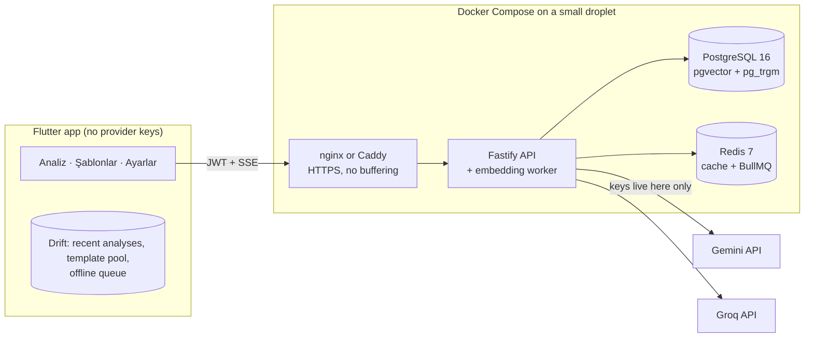

# Menü Kopilot

A personal field assistant for a delivery platform branch-opening specialist, used during the live phone call with
the restaurant. **One screen, one button:** screenshots of the restaurant's platform panel, a menu photo, or simply the
products typed/dictated during the call ("adana, urfa, ayran") → **Analiz et** → a result that can be scanned in
seconds:

- pinned on top: `Mevcut 5 ürün / hedef 10 — mutfak türü: Pide & Lahmacun`, the 10-product rule and the categories
  still short (`İçecek 0/2`); it moves as cards are accepted;
- **A · YENİ ÜRÜNLER** — products the menu does NOT have (never one it already has): name, a one-line description to
  paste, category, an estimated price range for the conversation, and why;
- **B · OPSİYON & MALZEME** — for products already on the menu: option groups (required/optional, single/multi,
  price effect), removable and extra ingredients;
- **C · EKSİK / DÜZELTME** — empty descriptions, abbreviated or wrong names, a product under the wrong heading.

Filter chips, bulk select + copy, one-tap copy per card, and a one-tap re-run with another cuisine when the
Classifier reads the menu differently. Behind it, six agents (Extractor → Classifier → Gap Analyst → Product
Recommender ∥ Option/Modifier → Validator) with a trace per step; the category expectations per cuisine live in
Postgres and are edited from the app. Extras: *Paylaş → Menü Kopilot* (a menu photo from WhatsApp, panel screenshots
from the gallery, a product list as text) and *Sesli not* (dictate product names; Groq Whisper, off in
`LOCAL_ONLY_MODE`).

> **Decision support, not an authority.** Suggestions come from templates and AI and must be confirmed with the
> restaurant; the app shows this warning on every result screen. The tool never talks to any delivery platform system:
> input is manual (typing, photos, screenshots) and output is copy/paste.
> **Templates never contain a price.** The only amount the app shows is a new product's *estimated* price range
> (`25–40 TL`), a prompt for the conversation that is never written into the template pool; prices read on photos
> are never assigned to a product.

| | |
|---|---|
| Spec | [`claude-code-prompt-menu-asistani.md`](claude-code-prompt-menu-asistani.md) |
| Provider research (Gemini, Groq) | [`docs/PROVIDER_NOTES.md`](docs/PROVIDER_NOTES.md) |
| Streaming contract (SSE) | [`docs/SSE_EVENTS.md`](docs/SSE_EVENTS.md) |
| Deploying next to other apps on `myserver` (nginx + Cloudflare) | [`docs/DEPLOY_MYSERVER.md`](docs/DEPLOY_MYSERVER.md) |
| Decisions / progress & acceptance status | [`DECISIONS.md`](DECISIONS.md) · [`PROGRESS.md`](PROGRESS.md) |

## Contents
1. [Architecture](#architecture)
2. [Security and privacy](#security-and-privacy)
3. [Local setup](#local-setup)
4. [Environment variables](#environment-variables)
5. [Getting the API keys](#getting-the-api-keys)
6. [Backend commands](#backend-commands)
7. [API overview](#api-overview)
8. [Deploying](#deploying)
9. [Android APK (build and signing)](#android-apk-build-and-signing)
10. [CI / release](#ci--release)
11. [Tests](#tests)
12. [Troubleshooting](#troubleshooting)

## Architecture



Token economy — the database and caches answer first, the LLM is the last resort:

1. **Retrieval without AI:** exact name → alias → `pg_trgm` similarity → pgvector (only approved templates). The
   316 seed templates in 27 cuisines aligned with the platform's kitchen categories (`source='seed'`, badge **Hazır şablon**)
   and every card the user approves (badge **DB'den**)
   come back with zero LLM calls (`cache_hit=true`).
2. **Caches (Redis, 30 days):** per-image extraction, recommender answers per gap set and voice transcriptions —
   the same photo or menu never costs twice.
3. **AI with a budget:** at most 6 agent calls / 25 k input tokens per analysis (plus one call per image) and a daily quota per user; images are read
   3 in flight, the two recommendation agents run in parallel under an 11 s deadline, and anything a model could not
   answer in time or in shape is filled from the database. The Validator checks every model answer in code (schema,
   dedupe against the menu, cuisine fit, category quotas) and asks the model again at most once.
4. **Provider router:** a fallback chain per task (e.g. vision: Gemini Flash → Groq Qwen), circuit breaker, rate-limit
   headers, cooldowns and full-jitter backoff. Prompts are versioned in the database (`prompt_templates`), not in the
   code.

| Path | What |
|---|---|
| `backend/` | Node.js 22 + TypeScript (strict) + Fastify 5, Drizzle ORM, PostgreSQL + pgvector, Redis + BullMQ, Zod |
| `mobile/` | Flutter (Android first; iOS kept buildable), Riverpod, go_router, Dio, Drift |
| `deploy/` | production compose file, nginx site for a shared server, `Caddyfile` for a fresh droplet |
| `scripts/` | provider-key guard, deploy script (builds the API image locally, copies it over ssh) |
| `docs/` | provider notes, SSE contract, myserver runbook |

## Security and privacy

- **Provider API keys exist only on the backend.** The mobile app contains no Gemini/Groq key or endpoint — not even
  in a `.env` (an APK can be decompiled). `scripts/check-no-provider-keys.ps1` and a CI job fail the build if one
  appears.
- The app authenticates with a short-lived JWT + rotating refresh token (hashed server side). There is a single
  account (created by the seed from `ADMIN_EMAIL` / `ADMIN_PASSWORD`); production refuses to start with the
  development defaults.
- Photos and screenshots are never stored on the server — only their SHA-256 (for caching). EXIF/GPS is stripped on
  the phone before upload.
- Release builds of the app talk to remote servers over **HTTPS only** (plain `http://` is accepted for `localhost`,
  i.e. USB testing with `adb reverse`). The app enforces this itself because `dart:io` ignores Android's
  `usesCleartextTraffic` flag.
- **`LOCAL_ONLY_MODE=true`** turns off every external API call: answers come only from the database and the caches
  (a photo read once is still usable from the cache; new photos cannot be read in this mode).

**Free-tier data use (read this before sending real menus).** Menu photos and panel screenshots belong to the
restaurant. On the **Gemini API free tier ("Unpaid Services")** Google's terms state that submitted content and
responses are used to provide, improve and develop Google products and machine-learning technologies, that human
reviewers may read and annotate API input and output, and they explicitly advise not to submit sensitive,
confidential or personal information; on paid tiers prompts and responses are not used to improve products and are
logged only for a limited period for abuse detection ([Gemini API Additional Terms](https://ai.google.dev/gemini-api/terms),
checked 2026-09-15, last updated 2026-04-28). Independently of the tier this backend sends every Gemini
interaction with `store: false`, so the Interactions API does not keep conversation state. **Groq** states that by
default it does not retain customer data for inference requests; inputs/outputs may be logged for up to 30 days for
reliability and abuse investigations unless **Zero Data Retention** is enabled in the console's Data Controls
([Groq: Your Data](https://console.groq.com/docs/your-data), checked 2026-09-15). Recommendations: use a paid Gemini
key (or keep Gemini for text-only tasks), enable Groq ZDR, never photograph documents with personal data, and switch
on `LOCAL_ONLY_MODE` when external processing is not acceptable. Policies change — re-check the linked pages.

Voice notes are sent to Groq for transcription and are not stored by this backend (only a hash for the cache); the
phone deletes the recording after upload.

## Local setup

Prerequisites (Windows 11 + PowerShell shown): Node.js ≥ 22, pnpm 11 (`corepack enable`), Docker Desktop, Flutter
(stable channel), JDK 17 and the Android SDK for the app.

```powershell
# 1. configuration (optional for a first run: compose has development defaults)
Copy-Item .env.example .env
#    edit .env: JWT_SECRET (openssl rand -base64 48), ADMIN_PASSWORD, GEMINI_API_KEY / GROQ_API_KEY

# 2. full stack: api + postgres(pgvector) + redis + caddy
docker compose up -d --build
#    http://localhost:3000/health/ready  → {"status":"ready"}
#    http://localhost:3000/docs          → Swagger UI (OpenAPI at /openapi.json)
```

### One command on the office PC (phone on USB)

```powershell
powershell -ExecutionPolicy Bypass -File scripts\dev-up.ps1                   # Docker, stack, health check, USB bridge
powershell -ExecutionPolicy Bypass -File scripts\dev-up.ps1 -Build            # after pulling new backend code
powershell -ExecutionPolicy Bypass -File scripts\dev-up.ps1 -FixDockerSocket  # Docker Desktop hangs while starting
```

[`scripts/dev-up.ps1`](scripts/dev-up.ps1) starts Docker Desktop when the engine does not answer, runs
`docker compose up -d`, waits for `/health/ready` and runs `adb reverse tcp:<API_PORT> tcp:<API_PORT>` for every phone
on USB, so the app's server address is `http://localhost:<API_PORT>` (3030 here). Release builds accept plain http
only for `localhost`/`127.0.0.1` — over the USB bridge the traffic never leaves the cable; any other server must be
https. Run it again after the phone was unplugged or the PC slept: the bridge does not survive that.

Backend development with hot reload (databases from compose):

```powershell
docker compose up -d postgres redis
cd backend
pnpm install
pnpm db:migrate
pnpm db:seed          # 27 cuisines, 316 templates, prompts v1, provider routes, admin user
pnpm dev              # http://localhost:3000
```

The app (debug builds allow plain HTTP to a local backend):

```powershell
cd mobile
flutter pub get
# emulator → host machine is 10.0.2.2; a real phone needs the PC's LAN IP
flutter run --dart-define=API_BASE_URL=http://10.0.2.2:3000
```

The server address can also be typed on the login screen and changed later in **Ayarlar → Sunucu**.

## Environment variables

All keys are listed in [`.env.example`](.env.example) (a test keeps it in sync with the Zod schema in
`backend/src/config/env.ts`, the only place that reads `process.env`).

| Variable | Default | Meaning |
|---|---|---|
| `NODE_ENV` | `production` | `development` / `test` / `production` (production rejects weak secrets) |
| `HOST`, `PORT` | `0.0.0.0`, `3000` | HTTP listener |
| `LOG_LEVEL` | `info` | pino level (`silent` in tests) |
| `TRUST_PROXY` | `true` | trust `X-Forwarded-*` from Caddy |
| `ROLE` | `all` | `api`, `worker` or `all` (API + embedding worker in one process — best for 1 GB) |
| `DATABASE_URL` / `REDIS_URL` | local URLs | compose overrides them with the internal service names |
| `POSTGRES_USER` / `POSTGRES_PASSWORD` / `POSTGRES_DB` | `menu` / `menu` / `menu_kopilot` | database container |
| `JWT_SECRET` | — | ≥ 32 random characters; required in production |
| `JWT_ACCESS_TTL`, `REFRESH_TOKEN_TTL_DAYS` | `12h`, `90` | token lifetimes |
| `ADMIN_EMAIL` / `ADMIN_PASSWORD` / `ADMIN_NAME` | — | the single account, created by the seed |
| `SEED_ON_START` | `true` | run migrations + idempotent seed when the API starts |
| `GEMINI_API_KEY`, `GROQ_API_KEY` | — | provider keys (server only); a missing key just removes that provider from the chains |
| `LOCAL_ONLY_MODE` | `false` | never call external APIs |
| `DAILY_LLM_CALL_QUOTA`, `DAILY_TOKEN_QUOTA`, `QUOTA_TIMEZONE` | `300`, `1500000`, `Europe/Istanbul` | per-user daily quota; after it the app answers from DB/cache only |
| `REQUEST_MAX_LLM_CALLS`, `REQUEST_MAX_INPUT_TOKENS` | `6`, `25000` | what the agents may spend per analysis; every image adds one call and 4 000 tokens on top; past it the remaining sections come from the database |
| `RETRIEVAL_TRGM_THRESHOLD`, `RETRIEVAL_VECTOR_THRESHOLD` | `0.72`, `0.85` | DB match thresholds |
| `CACHE_TTL_DAYS` | `30` | Redis cache lifetime |
| `UPLOAD_MAX_FILES`, `UPLOAD_MAX_FILE_MB` | `5`, `8` | photo upload limits |
| `API_PORT` | `3000` (production: `3030`) | host port of the API, bound to `127.0.0.1` only (compose) |
| `SITE_ADDRESS` | `:80` | Caddy site; a hostname (e.g. `api.example.com`) enables automatic HTTPS |

Model IDs and fallback chains are in `backend/src/config/models.ts`; the primary model per task can be changed from
**Ayarlar → Görev bazlı modeller** without a redeploy.

## Getting the API keys

Keys go **only** into the server's environment file — never into the app.

- **Gemini:** open [Google AI Studio → API keys](https://aistudio.google.com/apikey), sign in, *Create API key*
  (choose or create a Google Cloud project) → `GEMINI_API_KEY`. The free tier works for trying things out; see the
  privacy note above before using real menus, and enable billing on the project for the paid terms.
- **Groq:** open [Groq Console → API Keys](https://console.groq.com/keys), *Create API Key* → `GROQ_API_KEY`.
  Consider enabling Zero Data Retention under *Data Controls*.
- Verify both (live calls, costs a few requests): `cd backend; pnpm test:smoke`. The smoke tests are skipped when the
  keys are missing, so the normal test suite never needs them.

## Backend commands

Run from `backend/` (PowerShell: chain commands with `;`).

| Command | What |
|---|---|
| `pnpm dev` | API with hot reload (reads `../.env`) |
| `pnpm test` / `pnpm test:watch` | unit + integration + e2e (hermetic: PGlite with pgvector/pg_trgm, fake providers) |
| `pnpm test:smoke` | live provider checks (needs keys) |
| `pnpm live:check [--url https://…] [--skip-ai]` | end-to-end check of a running server over HTTP, independent of the app: auth rotation, categories, a typed analysis (three sections, no duplicate of the menu, no price in a template, < 15 s), trace, resume/replay, re-run with another cuisine, SSE order; with keys also panel screenshots and a menu photo. Never accepts a card. Uses `ADMIN_EMAIL` / `ADMIN_PASSWORD` from the environment or `../.env` |
| `pnpm measure --label <name>` · `pnpm compare` | quality measurement on the frozen menu fixtures (`test/fixtures/menus/`: duplicates, irrelevant, directly usable, category coverage, time) → `exports/quality-<name>.json`; `compare` prints the before/after table |
| `pnpm probe:recommender` | the Product Recommender alone on the fixture gaps (name noise, category fit) |
| `pnpm lint` · `pnpm typecheck` · `pnpm build` | ESLint (no `any`), `tsc --noEmit`, compile to `dist/` |
| `pnpm db:migrate` · `pnpm db:rollback` | apply / revert the last migration (every migration has a `drizzle/down/*.sql`) |
| `pnpm db:generate` | new migration from schema changes (add the matching down file) |
| `pnpm db:seed` | idempotent seed; never overwrites templates the user edited or seeds the user deleted |
| `pnpm db:export-seed [--from=files\|db] [--out=exports/seed-templates.csv]` | seed templates as a review CSV (UTF-8 BOM, `;`) |
| `pnpm fixtures:images` · `pnpm fixtures:record` | regenerate synthetic test images · re-record LLM fixtures with real keys |

## API overview

Everything is under `/api/v1` and needs `Authorization: Bearer <access token>` except login/refresh. Errors always
have the shape `{ "error": { "code", "message", "details?", "requestId" } }`. Interactive docs: `/docs` (blocked by
the production nginx site). Endpoints that are nothing but an AI call answer `AI_NOT_CONFIGURED` (409, names the
missing key), `LOCAL_ONLY_MODE` (409), `QUOTA_EXCEEDED` (429) or `PROVIDER_UNAVAILABLE` (503).

| Area | Endpoints |
|---|---|
| Auth | `POST /auth/login`, `POST /auth/refresh`, `POST /auth/logout`, `GET /auth/me` |
| Analysis | `POST /analyze` (multipart: `images[]` ≤ 5, `menuText?`, `cuisineId?`, `notes?`, `fromRunId?`, `debug?`; SSE with `Accept: text/event-stream`, `?async=1` → 202, otherwise the result), `GET /analyze/latest`, `GET /analyze/:runId`, `GET /analyze/:runId/events`, `GET /analyze/:runId/trace`, `POST /analyze/:runId/cancel`, `POST /suggestion-items/:id/accept`, `POST /suggestion-items/:id/skip` |
| Categories | `GET /categories`, `PATCH /categories/:key` (label, order, keywords), `GET/PUT /cuisines/:id/categories` (which categories a cuisine needs, with a minimum each) |
| Template pool | `GET /templates?q=&cuisineId=&source=&approved=&sort=usage\|name\|updated`, `GET/PATCH/DELETE /templates/:id`, `POST /templates` |
| Voice | `POST /transcribe` (multipart: `audio` m4a/mp3/ogg/wav/webm/flac, `language?`, `cuisineId?` → text + product names) |
| Settings | `GET/POST/PATCH/DELETE /cuisines`, `GET /settings/providers`, `PUT /settings/providers/:taskKey`, `GET /settings/quota`, `GET /usage/summary?range=today\|month`, `GET/POST /prompts`, `POST /prompts/:id/activate` (admin) |
| Health | `GET /health`, `GET /health/ready` (database + Redis) |

Streaming events and payload shapes: [`docs/SSE_EVENTS.md`](docs/SSE_EVENTS.md). An analysis streams
`run → classification → menu → counts → item* → done` (plus `trace` per agent step and `warning`), so the count
reaches the phone before the first card.

## Deploying

Nothing is built on the server — `pnpm install`/`tsc` would be OOM-killed on a small droplet. `scripts/deploy.ps1`
builds the API image on the PC (Docker Desktop), copies it over ssh, starts the stack and waits for `/health/ready`.
Migrations and the idempotent seed run when the API container starts (`SEED_ON_START`). Memory limits in
[`deploy/docker-compose.prod.yml`](deploy/docker-compose.prod.yml): Postgres 256 MB, API 384 MB, Redis 128 MB.

**On `myserver` (nginx + Cloudflare, next to other apps)** — `scripts/new-prod-env.ps1` writes `.env.production`
(random secrets, keys copied from the local `.env`, LF, nothing printed); the rest step by step in
[`docs/DEPLOY_MYSERVER.md`](docs/DEPLOY_MYSERVER.md): Cloudflare DNS record, `/etc/menu-kopilot/env`, the nginx site
from [`deploy/nginx/`](deploy/nginx/), then:

```powershell
powershell -File scripts/deploy.ps1                               # build + copy + start
powershell -File scripts/deploy.ps1 -SkipBuild -Tag <older tag>   # roll back to an image already on the server
```

The API listens on `127.0.0.1:3030` only; nginx terminates TLS (Cloudflare origin certificate) and proxies with
buffering off so SSE cards stream.

**On a fresh droplet** (no reverse proxy yet) the same compose file starts Caddy with automatic HTTPS:

```bash
# once, as root: Docker, swap, firewall, directories
curl -fsSL https://get.docker.com | sh
fallocate -l 2G /swapfile && chmod 600 /swapfile && mkswap /swapfile && swapon /swapfile \
  && echo '/swapfile none swap sw 0 0' >> /etc/fstab
ufw allow OpenSSH && ufw allow 80,443/tcp && ufw allow 443/udp && ufw --force enable
mkdir -p /etc/menu-kopilot /srv/menu-kopilot
```

Point a DNS `A` record at the droplet, put `SITE_ADDRESS=api.example.com` into `/etc/menu-kopilot/env` (plus the
values listed in the runbook) and run `powershell -File scripts/deploy.ps1 -WithCaddy`. Release images can also come
from GHCR (`.github/workflows/release.yml` on a `v*` tag): `-ImageSource ghcr -Tag 1.0.0`.

**Checks after every deploy**

- `curl -fsS https://<host>/health/ready` → `{"status":"ready",...}`
- `pnpm -C backend live:check --url https://<host>` (see the runbook for passing the admin password safely)
- `docker stats --no-stream` — the stack stays well below its limits; `free -m` shows swap
- SSE through the proxy: analysis cards appear one by one, not all at the end

**Windows → Linux pitfalls (already handled, keep it that way)**

- Line endings: `.gitattributes` forces LF for everything except `*.ps1`/`*.bat`; the deploy script also converts the
  uploaded compose file and strips CR characters from the server's env file.
- Case sensitivity: ext4 is case-sensitive; CI and the Docker build compile on Linux, which catches a wrong-case
  import before it reaches the server.
- Paths: code uses `node:path` / `URL` helpers only, never string-concatenated `\` paths.
- Permissions: `/etc/menu-kopilot/env` is `600`; the API container runs as a non-root user.

**Backups** (Postgres holds the approved templates — the valuable part):

```bash
# daily dump at 03:30, keep 14 days
cat > /etc/cron.d/menu-kopilot-backup <<'EOF'
30 3 * * * root mkdir -p /var/backups/menu-kopilot && docker exec menu-kopilot-postgres-1 pg_dump -U menu -d menu_kopilot -Fc > /var/backups/menu-kopilot/$(date +\%F).dump && find /var/backups/menu-kopilot -name '*.dump' -mtime +14 -delete
EOF
```

## Android APK (build and signing)

```powershell
cd mobile
flutter build apk --debug                       # quick test build — installs next to the release app as "Kopilot TEST"
flutter build apk --release                     # fat APK (all ABIs, ~65 MB)
flutter build apk --release --split-per-abi     # smaller per-ABI APKs; most phones need app-arm64-v8a-release.apk
# the office build: arm64 only, production server prefilled, signed with the release key
flutter build apk --release --split-per-abi --target-platform android-arm64 --dart-define=API_BASE_URL=https://menu.example.com
```

Release signing: the production key lives in `%USERPROFILE%\.android-keys\menu-kopilot\` (`menu-kopilot-upload.jks` + a copy of
`key.properties`, created 2026-09-21 on the `old-pc` machine, certificate `CN=Menu Kopilot, O=bcsakalar, C=TR`, SHA-256
`DE:00:43:5B:E8:64:85:7C:A6:CB:B9:59:5F:BF:BC:09:9F:E9:0B:99:FE:48:5E:E9:98:38:9F:25:48:52:14:E6`); `mobile/android/key.properties`
points at it and is git-ignored. Builds up to 1.0.0 were signed with an earlier key that stayed on another PC
(DECISIONS D-166): a phone with such a build uninstalls it once before installing 1.1.0. On a new machine copy that folder back and the same `key.properties` into `mobile/android/`. For a brand-new key
`powershell -File mobile/scripts/create-keystore.ps1` asks for a password and writes both files. Without `key.properties` a release build is signed with the debug key (fine for your own phone, not for
distribution). **Back up the keystore and its password** — an app signed with a different key cannot be installed
over the existing one.

Install on the phone: copy the APK and allow "install unknown apps" for the file manager, or
`adb install -r build\app\outputs\flutter-apk\app-release.apk`. Set the default server with
`--dart-define=API_BASE_URL=https://menu.example.com` (release builds only allow HTTPS; `http://localhost`
works for USB testing: `adb reverse tcp:3030 tcp:3030` and `--dart-define=API_BASE_URL=http://localhost:3030`).

App icon and splash: the adaptive launcher icon is a vector
(`android/app/src/main/res/drawable/ic_launcher_foreground.xml`, plus a monochrome variant for Android 13 themed
icons); `powershell -File mobile/scripts/generate-app-icons.ps1` renders the legacy Android and the iOS PNG icons from
the same geometry.

iOS: the project stays buildable, but building requires macOS/Xcode (not possible on Windows).

## CI / release

- [`ci.yml`](.github/workflows/ci.yml) — on push/PR: backend `lint` + `typecheck` + `test` + `build` (Node 22), mobile
  `flutter analyze` + `flutter test` (stable channel), and the provider-key guard.
- [`release.yml`](.github/workflows/release.yml) — on a `v*` tag or manually: signed release APK as a workflow
  artifact (secrets `ANDROID_KEYSTORE_BASE64`, `ANDROID_KEYSTORE_PASSWORD`, `ANDROID_KEY_PASSWORD`,
  `ANDROID_KEY_ALIAS`; optional repository variable `API_BASE_URL`) and the API image pushed to GHCR (linux/amd64).

## Tests

- Backend: `cd backend; pnpm test` — ~700 tests: Turkish normalization, price guard, env, seed data, JSON-schema
  conversion, provider adapters and router resilience (fallback, circuit breaker, 429 cooldown), migrations up → down
  → up, the agents one by one (dedupe across screenshots, category classification and gaps, name cleaning, option
  merge on accept) and end-to-end runs of the pipeline against recorded fixtures: three sections, no new product
  that is already on the menu, category quotas, a failing agent → partial result, re-run with another cuisine without
  re-reading the images, typed products without keys, LOCAL_ONLY_MODE, voice notes, the product-type knowledge base
  and grounding (absurd groups removed, ingredients separated from options, 6–8 word descriptions, coverage), the
  matching guard, the learning loop (products turned down per cuisine, favoured suggestions first, "Geri al") and the
  analysis history (filters, paging by time). Fixtures are hand-written stand-ins; see
  `backend/test/fixtures/llm/README.md`.
- Mobile: `cd mobile; flutter analyze; flutter test` — ~75 tests: SSE parser, models, error texts, HTTPS rule,
  offline queue (re-runs, requests queued by older versions), template pool cache, photo limits, and widget tests
  (result screen: pinned counter, the two tabs, the four sections of a product card, one-tap removal and "kabul et"
  sending only what was kept, per-section copy, cards that open and close, notes, live counter, cuisine re-run; the
  analysis history — days, times, filters, offline; "Ekibin sildikleri" with "Geri al"; category settings; voice note
  button; sharing into the app).
- AI quality: `tests/ai_eval/` — 141 scenarios over all 27 cuisines, scored by independent rules
  ([`tests/ai_eval/README.md`](tests/ai_eval/README.md); reports in [`docs/ai-eval/`](docs/ai-eval/)).
- Live: `cd backend; pnpm live:check` against the running stack (see Backend commands).
- Acceptance criteria and what still needs a real device / real keys: [`PROGRESS.md`](PROGRESS.md).

## Troubleshooting

- **Cards do not stream / arrive all at once** — a proxy is buffering. With Caddy keep `flush_interval -1`; with
  another proxy disable response buffering for `text/event-stream`.
- **`quota_exceeded` / `local_only` warnings** — the daily quota is used up or `LOCAL_ONLY_MODE` is on; the app keeps
  answering from the database and caches. **Ayarlar → Kullanım** shows calls, errors and cache/DB hit ratios.
- **"AI anahtarı tanımlı değil"** — no `GEMINI_API_KEY` / `GROQ_API_KEY` on the server. Typed products and the
  seed/approved templates keep working (all three sections, answered from the database). Add a key to the server's
  env file and redeploy (Ayarlar → Görev bazlı modeller shows provider status).
- **A key is rejected (403 `PERMISSION_DENIED`, "Your project has been denied access")** — the provider disabled the
  project behind the key; its routes fail and the chains fall back to the other provider. Create a new key in a
  healthy project and replace it in the env file.
- **Photos are not read** — no provider key (above), or both providers are down (circuit breaker opens for 60 s
  after 3 failures).
- **The app still talks to the old server** — the address is stored on the phone after the first login; change it in
  **Ayarlar → Sunucu adresi**.
- **Sesli not does nothing** — it needs `GROQ_API_KEY` (Whisper exists only on Groq), is refused in
  `LOCAL_ONLY_MODE` and needs the microphone permission on the phone.
- **A photo is sometimes not read on a free tier** — Groq's free per-minute limit for the vision model is reached
  after a few images in a row; with a working Gemini key the chain falls back to it, otherwise that image is skipped
  with a warning. For daily office use prefer Groq's Dev tier and Gemini Tier 1.
- **The app shows skeletons forever on a USB phone** — the `adb reverse` bridge dropped (cable replugged, PC slept):
  run `scripts/dev-up.ps1` again.
- **Release build warns about the Kotlin Gradle Plugin** (`flutter_image_compress_common`, `workmanager_android`) —
  upstream plugin issue, the build still succeeds; upgrade the plugins before upgrading Flutter (DECISIONS D-088).
- **Docker Desktop fails to start on Windows** — a stale `sailor-ingest.sock` in `%LOCALAPPDATA%\Docker\run` cannot be
  deleted (DECISIONS D-056, D-132): `scripts/dev-up.ps1 -FixDockerSocket` stops Docker Desktop, moves the folder aside
  and starts it again. The backend tests do not need Docker.
