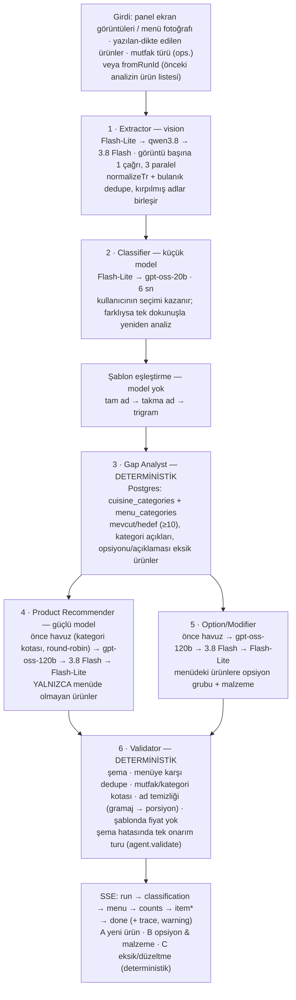

# FAZ 3 — Rapor

Tarih: 2026-09-21 · Kapsam: FAZ 0 (teşhis) → FAZ 1 (uygulama) → FAZ 2 (test) → FAZ 3 (bu rapor).
Karar kaydı: `DECISIONS.md` D-150 … D-165 · Teşhis: `docs/FAZ0_TESHIS.md` · API/SSE sözleşmesi: `docs/SSE_EVENTS.md`.

## 0. Önce bunları oku

> **Güncelleme (aynı gün, §10):** aşağıdaki üç madde o gün kapandı — Flutter bu bilgisayara kuruldu, mobil kod
> derlendi ve 56/56 test geçti; production güncellendi (canlı kontrol 15/15, menü fotoğrafı dahil — reddedilen
> Gemini anahtarı yalnızca bu PC'nin yerel `.env`'indeki); imzalı 1.1.0 APK ve ikinci hesap hazır.

1. **Mobil kod bu makinede derlenmedi.** Bu bilgisayarda Flutter/Android SDK yok, telefon USB'de görünmüyor.
   SDK kurmak indirme + lisans kabulü gerektirdiği için yapmadım. Bunun yerine derleyicinin yakalayacağı hataları
   arayan statik denetimler yazdım (import erişilebilirliği, `Sınıf.üye` kontrolü, l10n anahtar/parametre kontrolü);
   **gerçek derleme hataları buldu ve düzeltildi** (bkz. §7). Yine de ilk iş: `flutter analyze` + `flutter test`
   (komutlar §9'da). Bu yüzden **cihaz ekran görüntüsü yok** (§6).
2. **Gemini anahtarı reddediliyor:** bu sabahtan beri her Gemini çağrısı 403 `PERMISSION_DENIED` — "Your project
   has been denied access. Please contact support." Dün gece aynı anahtarla 49 başarılı çağrı var. Bütün zincirler
   şu an Groq'ta çalışıyor; Groq'un ücretsiz katmanı vision modelinde dakikada 1000 çıktı token'ına izin verdiği için
   **15 ürünlü bir menü fotoğrafı okunamıyor** (panel ekran görüntüleri okunuyor). Production aynı anahtarı
   kullanıyorsa orada da aynı durum var. Çözüm: AI Studio'da projeyi kontrol et ya da yeni bir projede anahtar üret.
3. **Hiçbir şey commit edilmedi, deploy edilmedi.** Production'a çıkınca migration 0003 çalışır ve **şube
   tablolarını siler** (istenen buydu; geri alma migration'ı tabloları boş olarak geri kurar, satırlar geri gelmez).
   Deploy'dan önce taze bir `pg_dump` al.

---

## 1. FAZ 0 teşhis özeti

| Ekran | Canlı görüşmede | Teşhis → karar |
|---|---|---|
| Öneri | Kısmen | Sonuç düz bir kart listesiydi; **21 kartın 21'i menüde zaten olan ürün**, 0 yeni ürün. → Üç bölümlü tek analiz ekranı |
| Tamamla | Hayır | Analizden önce şube kaydı zorunluydu; aynı menü Öneri'ye ayrıca girilmeliydi; "şu alan boş" diyordu, ne yazılacağını söylemiyordu. → **Öneri ile birleştirildi** |
| Şubeler | Hayır | Tek kullanıcı, her görüşme tek seferlik; varlık sebebi Tamamla'nın zorunluluğuydu. → **Silindi** |
| Araştırma | Hayır | Şubeye bağlıydı. → **Silindi** |
| Şablonlar, Ayarlar | Evet | Kaldı; Ayarlar'a kategori düzenleme eklendi |

Önce ölçümü (aynı dört menü): Tamamla'nın veritabanı önericisi **kategori körüydü** — pide menüsüne 7 önerinin 6'sı
yine pide, kafeye 7'nin 7'si yine içecek; kategori açıklarının yalnızca **1/11**'ini kapatıyordu. Modeli tek başına
çağırınca önerilerin **%24'ü ürün değil/alakasız**, **%11'inin adında gramaj/ambalaj** ("Ayran (1 L)") vardı.

**Tamamla kararı: birleştir.** FAZ 1'in Öneri ekranından istediği dört şey (ilerleme göstergesi, yeni ürünler,
mevcut ürünlere opsiyon, eksik/düzeltme) Tamamla'nın kendisiydi. İki ekranda tutmak görüşme sırasında aynı menüyü
iki kez girmek demekti. Tamamla'nın değerli mantığı (dedupe, sayaç, eksik alan tespiti) silinmedi; ajanların içine
taşındı ve tek sonuç ekranında bölüm olarak görünüyor. Kaybolan tek şey ayrı sekme ve şube kaydı.

---

## 2. Yapılanlar

### 2.1 Tek analiz ekranı

- **Giriş:** mutfak türü (boş bırakılabilir — Classifier bulur) · menüdeki ürünler (yaz / dikte et) · panel ekran
  görüntüleri veya menü fotoğrafı (≤ 5) · not · "Analiz et". Altında **son analizler** (telefon kilitlendi, uygulama
  kapandı, arada başka restoran geldi → tek dokunuşla geri açılır).
- **Sonuç ekranı, üstte sabit:** `Mevcut 5 ürün / hedef 10` · `mutfak türü: Pide & Lahmacun ▾` (dokun → başka mutfak
  seç → menü yeniden okunmadan ~2,5 sn'de yeniden analiz) · segmentli çubuk · `Açılış için en az 10 ürün gerekli ·
  5 ürün eksik` · eksik kategoriler (`İçecek 0/2`, `Çorba 0/1`). **Öneri eklendikçe canlı güncellenir** (toplam ve
  kategori hapı birlikte). Altında sabit filtre çipleri: `Tümü · Yeni ürün · Opsiyon · Düzeltme` (sayılı).
- **Bölümler** (her biri ayrı renk ve ikon, başlığı yalnızca kendi bölümü ekrandayken yapışık, başlıkta sayı ve
  "Hepsini seç"):
  - **A · YENİ ÜRÜNLER** (paprika/kırmızı vurgu, ⊕): ad · yapıştırılabilir tek satır açıklama · kategori hapı ·
    tahmini fiyat aralığı hapı (`25–40 TL`, yalnızca görüşme notu, şablona asla yazılmaz) · tek satır gerekçe ·
    **Ekle · Düzenle · Reddet · kopyala**.
  - **B · OPSİYON & MALZEME** (yeşil, ⚙): en üstte **hangi ürün için** (paneldeki yazımıyla) · grup adı ·
    `tek seçim · zorunlu` · seçenekler hap olarak, fiyat etkisi yazıyla (`Tam · tabanı belirler`, `Ekstra Kaşar · ek
    ücretli`; hepsi ücretsizse kural satırında `ücretsiz`) · çıkarılabilir / ekstra malzeme · grup başına kopyala.
  - **C · EKSİK / DÜZELTME** (amber, ✎): açıklaması boş ürün (havuzda varsa yapıştırılacak açıklamayla), kısaltılmış /
    yanlış ad (`Karışık Pd → Karışık Pide`), yanlış başlık altındaki ürün.
- **Toplu seçim + kopyala:** kartlardaki onay kutuları veya bölüm başına "Hepsini seç" → alt çubukta "Panoya kopyala"
  (seçilenler panele yapıştırılacak düz metin olarak). Karar verilen kart seçimden düşer.
- **Gizli debug ekranı:** sonuç ekranındaki böcek simgesi → her ajan adımı: süre, sağlayıcı/model, token, çağrı
  sayısı, hata; girişte "Ayrıntılı kayıt" açıksa her adımın girdisi/çıktısı.

### 2.2 Şubeler silindi (bağımlılıklar önce çözüldü)

Route, servis, şemalar, şube menüsü birleştirme, şube CSV/JSON dışa aktarma, mobil ekranlar/provider/modeller, sekme,
DB tabloları (`branches`, `branch_menu_snapshots`, `branch_menu_items`, `suggestion_runs.branch_id`) — migration 0003
+ geri alma dosyası. Şubeye bağlı "İnternette araştır" ve onun kullandığı Groq `compound` desteği ile `contact-guard`
de gitti. Ölü kod/kullanılmayan import kontrolü: backend `eslint` + `tsc` temiz; mobilde silinen her üst düzey
sembolün kalan referansı tarandı (0), boşa düşen 16 l10n metni silindi. Tam liste §3'te.

### 2.3 Agent pipeline



- 4 ve 5 **paralel** çalışır; ikisine birlikte **11 sn** süre sınırı var, dolarsa veritabanı cevapları gider
  (uyarıyla). Deneme başına zaman aşımı: sınıflandırma/öneri/opsiyon 6 sn, onarım 8 sn, görüntü okuma 18 sn.
- Her model ajanının **ayrı prompt dosyası ve ayrı JSON şeması** var (`backend/src/agents/prompts`, `…/schemas`);
  şemadan geçmeyen çıktı ekrana ulaşmaz — Validator bir kez onarım ister, yine geçmezse o kısım düşer.
- **Ajan başına model** Ayarlar → Görev bazlı modeller'den değiştirilebilir (Gemini/Groq seçimi kullanıcıda).
- **Her adım loglanır** (`agent_steps`): girdi/çıktı (yalnızca debug açıkken), süre, token, çağrı, sağlayıcı/model.
- **Kısmi sonuç:** bir ajan hata verirse koşu durmaz; o ajanın yedeği kullanılır, uyarı gösterilir, durum `partial`.
- **Bütçe:** yapılandırılan bütçe (6 çağrı / 25 k token) ajanlar içindir; her görüntü ayrıca 1 çağrı + 4 k token
  getirir (D-165 — rapor yazılırken bulundu: ortak bütçede 5 ekran görüntüsü öneri ajanlarını aç bırakıyordu).

### 2.4 Mutfak şablonları ve min hedefler Postgres'te, uygulamadan düzenlenebilir

- `menu_categories`: kategori adı, sırası, **anahtar kelimeleri** (ürün adında geçen tam kelime; boşluklu anahtar
  kelime ifade olarak eşleşir: "sıcak çikolata").
- `cuisine_categories`: her mutfağın beklediği kategoriler ve her birinde **en az kaç ürün**.
- Uygulamada: **Ayarlar → Kategoriler ve anahtar kelimeler** · **Ayarlar → Mutfak türleri → ⋮ → Kategoriler ve min.
  sayılar** (işaretle, −/+ ile sayı). API: `GET/PATCH /categories`, `GET/PUT /cuisines/:id/categories`.
- Düzenleme bir sonraki analizde geçerli; her açılışta çalışan seed **kullanıcının düzenlediği satırlara dokunmaz**
  (ve seed şablonlarının kategorisini yeni anahtar kelimelere göre hemen günceller).

---

## 3. Değişen / silinen dosyalar

Toplam: 133 dosya değişti, **+3,3 bin / −14,9 bin satır** (net ~11,6 bin satır azaldı; yeni dosyalar hariç).

<details><summary><b>Silinen (61)</b></summary>

Backend: `src/db/schema/branches.ts`, `src/lib/contact-guard.ts`,
`src/modules/branches/{branch-menu,routes,schemas,service}.ts`, `src/modules/export/branch-export.ts`,
`src/modules/gap/{completeness,dedupe,menu-merge,pipeline,questions,recommend,routes,schemas,service,store}.ts`,
`src/modules/research/{routes,schemas,service}.ts`,
`src/modules/suggest/{canonicalize,enrichment,format,pipeline,prompt-parse,routes,sanitize,schemas,service,store}.ts`
(`run-registry.ts` → `src/lib/`), testler `test/e2e/{branch-menu,gap,suggest,voice-research}.e2e.test.ts`,
`test/unit/{gap-helpers,suggest-helpers,voice-research}.test.ts`, fixture'lar `test/fixtures/llm/{enrich-items.json,
panel/*,research/*}`.

Mobil: `lib/data/models/{branch,gap,suggestion}.dart`, `lib/features/branches/*` (4), `lib/features/gap/*` (3),
`lib/features/research/*` (2), `lib/features/results/{run_controller,suggestion_card}.dart`, testler
`test/unit/{gap,run_controller}_test.dart`, `test/widget/{branch_detail_screen,gap_result_screen,suggestion_card,
voice_research}_test.dart`; `lib/data/models/voice_research.dart` → `transcription.dart`.
</details>

<details><summary><b>Yeni (29 yol)</b></summary>

Backend: `src/agents/` (6 ajan, tracer, dedupe, pipeline, prompts/, schemas/), `src/modules/analyze/`
(routes, schemas, service, store), `src/domain/category.ts`, `src/db/schema/{agents,categories}.ts`,
`src/db/seed/categories.ts`, `drizzle/0003_agents_categories.sql` + `drizzle/down/…`,
`scripts/{measure-quality,compare-quality,probe-recommender}.ts`, testler `test/e2e/analyze.e2e.test.ts`,
`test/e2e/analyze-safety.e2e.test.ts`, `test/unit/{agents,voice-routing}.test.ts`, fixture'lar
`test/fixtures/menus/*` (dört dondurulmuş menü), `test/fixtures/llm/{recommend-items.json,extract/panel-*.json}`.

Mobil: `lib/data/models/analysis.dart`, `lib/features/results/{analysis_controller,section_cards,
pipeline_debug_screen}.dart`, `lib/features/settings/category_settings_screen.dart`, testler
`test/widget/{results_screen,category_settings,voice_note}_test.dart`, `test/unit/pending_queue_test.dart`.

Doküman: `docs/FAZ0_TESHIS.md`, `docs/FAZ3_RAPOR.md`.
</details>

<details><summary><b>Değişen (68)</b></summary>

Backend: AI katmanı (`ai/router.ts` — deneme başına token, `route-repository`, `providers/groq` — compound çıktı,
`types`), `config/models.ts` (ajan görevleri, zincirler, zaman aşımları), `app.ts`, şema (`cuisines`, `enums`,
`menu-items`, `relations`, `suggestions`, `index`), seed (`seed.ts`, `prompts.ts`), `i18n/tr.ts`,
`modules/cuisines/*` (kategori API'si), `modules/templates/template-store.ts` (yeniden sınıflandırma),
`modules/{extraction,retrieval,usage,voice}`, `scripts/{live-check,record-fixtures}.ts`, `package.json`, testler
(migrations, seed, router, settings, cuisines, providers, smoke, helpers), LLM fixture'ları.

Mobil: `core/network/api_client.dart`, `core/widgets/common.dart` (`showFieldEditor` taşındı), `core/storage/
app_database.dart`, `core/design/skeleton.dart`, `core/utils/haptics.dart`, `data/models/{common,template_item}.dart`,
`features/home/*`, `features/offline/pending_queue.dart`, `features/results/results_screen.dart` (yeniden yazıldı),
`features/settings/*`, `features/share/share_listener.dart`, `features/shell/app_shell.dart`, `router.dart`,
`l10n/app_tr.arb` + üretilmiş iki dosya, testler.

Kök: `README.md`, `DECISIONS.md`, `PROGRESS.md`, `docs/{SSE_EVENTS,DEPLOY_MYSERVER,PROVIDER_NOTES}.md`.
</details>

---

## 4. Önce / sonra (FAZ 2 — aynı dört menü, soğuk önbellek)

Ölçüm: `pnpm measure` çalışan Docker yığınına HTTP ile gider (telefonla aynı çağrılar), sonuçları dondurulmuş bir
hakemle değerlendirir; `pnpm compare` tabloyu üretir. Hakem sonuçları gördükten sonra **değiştirilmedi**.

| Ölçüt | Önce | Sonra |
|---|---|---|
| Öneri ekranında **yeni ürün** | **0** (21 kartın 21'i menüde zaten olan ürün) | **26**, hepsi menüde olmayan ürün |
| Yeni ürün — menüde zaten olan (tekrar) | Tamamla DB yolu 0/27 | **0/26 (%0)** |
| Yeni ürün — mutfağa alakasız | DB yolu 0/27 · model tek başına 18/75 (%24) | **0/26 (%0)** |
| Yeni ürün — adında gramaj/ambalaj | model tek başına 8/75 (%11) | **0** |
| Yeni ürün — doğrudan kullanılabilir | DB yolu 27/27 ama kategori körü · model tek başına 57/75 (%76) | **26/26 (%100)** |
| **Kategori açığı kapatma** | **1/11 (%9)** | **10/11 (%91)** |
| Opsiyon / düzeltme kartı | yoktu (Tamamla yalnızca "şu alan boş" diyordu) | **23**, hepsi menüdeki bir ürüne bağlı, 23/23 kullanılabilir |
| Uçtan uca süre, analiz başına | 168 ms (hiç model çağrısı yok, DB yolu) | **2,8–3,5 sn** soğuk (2 model çağrısı) |
| 15 sn hedefi | — | ✓ (bu oturumda görülen en kötü tek koşu 12,2 sn — 11 sn süre sınırı sayesinde) |

Dürüst notlar:
- `pnpm compare`'in ham çıktısında "önce" sütununda "opsiyon/düzeltme 21/21 kullanılabilir" görünür: o 21 kart
  opsiyon kartı değildi, eski Öneri ekranının **menüdeki ürünleri yeniden kartlaştırmasıydı** (teşhiste 21/21 tekrar).
  Karşılaştırılabilir değil; yukarıdaki tabloda bu yüzden "yoktu" yazıyor.
- "Önce"nin 168 ms'i hiç model çağırmayan DB yolu; "sonra" gerçek model çağrısı içeriyor ve yine 15 sn'nin çok altında.
- LLM çıktısı koşudan koşuya değişiyor: aynı günün bir önceki koşusunda kafe için "Börek" ve "Kek" hakem tarafından
  "alakasız" sayıldı (26 yerine 24 kullanılabilir). İkisi de hakemin kendi kelime listesinden: hakemin listesinde
  `kek` yok ("Kek" ana yemek sanıldı), börek ara sıcak sayılıyor. Kafede ikisi de olağan. Bu sırada **sunucunun
  taksonomisinde de `kek` olmadığı** ortaya çıktı (kafedeki "Islak Kek" tatlı sayılmıyordu) — düzeltildi.
- Aynı koşuda tatlıcı için 2 opsiyon kartı "menüde olmayan ürüne ait" sayılmıştı: kart, paneldeki "Kadayıf" yerine
  havuzdaki "Tel Kadayıf" adıyla başlıklanıyordu. Gerçek bir hataydı (görüşmede kullanıcı paneldeki adı arar,
  kabul edince paneldeki yazım takma ad olarak da kaydedilmiyordu) — düzeltildi (D-158), testle korunuyor.
- Kapanmayan tek açık: tatlıcıda "atıştırmalık". Veritabanındaki "Tatlı" mutfağı atıştırmalık beklemiyor
  (`tatli:7, icecek:3`), FAZ 0 fixture'ı bekliyordu. Artık uygulamadan eklenebilir.
- Yalıtılmış model probu (FAZ 0 §3c'nin "sonra"sı — Validator ve havuz OLMADAN, yalnızca Product Recommender'ın
  ham cevabı; kullanıcıya giden şey değil): 8 çağrının 6'sı cevap verdi (biri Groq dakika limiti → Gemini 403, biri
  6 sn zaman aşımı), 36 öneri. **Tekrar %0 (önce %0), adında gramaj/ambalaj 0/36 (önce 8/75, %11).** Aynı hakem
  "alakasız"ı 12/36 (%33; önce 18/75, %24) sayıyor, ama tek tek bakınca: bu hakem "alakasız"ı fixture'ın dondurulmuş
  açık-kategori listesine göre sayıyor, oysa model veritabanının açık saydığı kategorilere öneri yapıyor (kebapçıda
  ana yemek → "İskender Kebap", kafede içecek → "Soğuk Çay", "Meyve Suyu"); "Kek", "Croissant", "Bagel" hakemin kelime
  listesinde olmadığı için ana yemek sanılmış. 12'nin içinde gerçekten yersiz olan yalnızca tatlıcıya önerilen
  "Şalgam" (kafeye "Baklava" tartışmalı). Önceki %24'ün içindekiler ise gerçekten ürün değildi ("Kaymak", "Demleme
  Çay", "Kısırlık Bulgur Pilavı"). Kullanıcıya giden uçtan uca sonuçta (yukarıdaki tablo) Validator'ın kotası ve
  havuz eşleşmesi bu tür sapmaları eliyor.

---

## 5. Backend bağımsız doğrulama (arayüzden bağımsız)

- **Testler:** 538/538 (birim + entegrasyon + e2e, PGlite + sahte sağlayıcılar), `eslint` ve `tsc` temiz.
  Ajanları tek tek, üç bölümü, "menüde olan ürün asla önerilmez"i, kategori kotalarını, bir ajan hata verince kısmi
  sonucu, tek onarım turunu, şablonu inceltmeyen kabulü, mutfak değiştirip görüntüyü yeniden okumadan analizi,
  kategori düzenlemenin seed'den sağ çıkmasını ve 5 ekran görüntülü bütçeyi kapsıyor.
- **Canlı kontrol** (`pnpm live:check`, yerel Docker, gerçek anahtarlar, telefondan bağımsız HTTP): **14/15**.
  Sağlık, oturum/yenileme, 401, kategoriler, yazılı pide menüsü → üç bölüm (0,3–5,9 sn), iz kaydı (6 ajan),
  son analiz/anlık görüntü/olay tekrarı, **mutfak değiştirip yeniden analiz 0,4–2,6 sn (Extractor atlandı)**, SSE
  sırası (sayaç 0,3–0,4 sn'de, ilk karttan önce), kart reddetme, ayarlar, **iki panel ekran görüntüsü 2,0–2,2 sn
  (12 ürün, ikisi de okundu)**, kaldırılan uçlar 404. Üç ayrı koşuda aynı sonuç. Başarısız olan: 15 ürünlü menü fotoğrafı (§0.2 — Gemini reddi + Groq ücretsiz sınırı).

---

## 6. Ekran görüntüleri

**Alınamadı.** Bu makinede Flutter/Android SDK yok ve telefon USB'de görünmüyor; SDK kurmak indirme + lisans kabulü
gerektiriyor ve bunu izinsiz yapmadım. "Önce" görüntüleri de aynı sebeple yok. Ekranın söylediklerini widget
testleri doğruluyor (`mobile/test/widget/results_screen_test.dart`: sabit sayaç metni `Mevcut 5 ürün / hedef 10`,
`mutfak türü: …`, 10 ürün kuralı, kategori hapları, üç başlıklı ve sayılı bölüm, opsiyonun fiyat etkisi, filtre,
toplu seçim, bölüm başına "Hepsini seç", kabul edince sayacın ve kategori hapının anında değişmesi, mutfak
değiştirip yeniden analiz; `category_settings_test.dart`: kategori ve min. sayı düzenleme) — ama bunlar da **henüz
çalıştırılmadı**. Cihazda çekilecek görüntü listesi §9'da.

---

## 7. Kararlar ve gerekçeler (özet — ayrıntı `DECISIONS.md`)

| # | Karar | Gerekçe |
|---|---|---|
| D-152 | Tamamla, Öneri ile **birleşti** | Aynı girdi, iki ayrı akış; FAZ 1'in istediği dört bölüm Tamamla'nın kendisiydi |
| D-150/151 | Şubeler + araştırma + Groq compound tamamen silindi | Görüşmede kullanılmıyor; yarım silinmiş özellik bakım yükü |
| D-153 | Gap Analyst ve Validator **deterministik** | Sayma ve küme farkı için model gereksiz, yavaş ve aritmetiği şaşırabiliyor; denetlenebilir pipeline |
| D-154 | Mekanik işler küçük modelde, öneri güçlü modelde; 11 sn ortak süre sınırı | Bir kez 24,6 sn ölçüldü; sınırla en kötü durum 15 sn içinde |
| D-155/156 | Kategoriler Postgres'te, uygulamadan düzenlenir, seed düzenlemeyi ezmez | "Sonradan ben düzenleyebileyim"; seed her açılışta çalışıyor |
| D-157 | Kategori kotası + sırayla dağıtım | Pide menüsüne 6 pide önerisi (1/11 kapatma) |
| D-158 | Opsiyon kartı kabulde şablona **birleşir**, üzerine yazmaz | İlk sürüm seed şablonlarını inceltiyordu (testle bulundu) |
| D-159 | Yeni ürün kartında tahmini fiyat aralığı, şablonda asla | İstenen görüşme notu; havuz fiyatsız kalır |
| D-160 | Mutfak değişince menü yeniden okunmaz (`fromRunId`) | Classifier override'ı 2,5 sn'ye iner, vision maliyeti yok |
| D-161 | Sabit şerit + bölüm başına yapışık başlık | Üç başlık birden yapışınca 168 px ekran gidiyordu |
| D-162 | Mobil statik denetim + CI önerisi | SDK yok; statik denetim 3 gerçek derleme hatası buldu (`showFieldEditor` silinen dosyadaydı, `AppDatabase.forTesting` yok, eksik test importları) |
| D-165 | Görüntü başına ayrı bütçe payı | 5 ekran görüntüsünde öneri ajanları bütçeden reddediliyordu |

---

## 8. Kalan riskler ve TODO

1. **Mobil derlenmedi / testleri koşulmadı** — statik denetim temiz, ama tip hataları yalnızca derleyicide çıkar.
2. **Gemini reddi** — düzelene kadar büyük menü fotoğrafları okunamaz (ücretsiz Groq sınırı). Ofis kullanımı için
   Groq Dev katmanı ve Gemini Tier 1 önerilir.
3. **Production migration'ı** şube verisini siler (istenen); deploy öncesi taze yedek.
4. **Yerel geliştirme veritabanı** 0003'ün ara hâliyle kurulmuştu: `fix_kind` enum'unda artık kullanılmayan iki değer
   duruyor (zararsız) ve iki yeni sütun elle `ALTER` ile eklendi. Production temiz 0003 alacak.
5. **Görüntü okuma deneme sınırı 18 sn** — birincil vision modeli çökerse (yedeğe düşülürse) toplam 15 sn'yi
   aşabilir; normal yolda ~2–3 sn.
6. **Model çıktısı değişken** — aynı menüye her koşuda birebir aynı öneriler gelmiyor; kotalar ve Validator sınırları
   koruyor, içerik değişebiliyor.
7. **Fixture beklentileri ile DB mutfak beklentileri farklı** (ör. Tatlı mutfağında atıştırmalık) — artık
   uygulamadan ayarlanabilir; ekibin kendi minimumlarını girmek kullanıcıda.
8. `ChecklistTicks` Drift tablosu kullanılmıyor; kaldırmak Drift migration'ı + `build_runner` ister (SDK gerekli).
9. Kullanılmayan 5 eski l10n metni (bu çalışmadan önce de kullanılmıyordu) duruyor.

---

## 9. Senin çalıştırman gerekenler

```powershell
# 1) Mobil: Flutter olan bir makinede (veya PR açıp CI'ın yapmasını bekle)
cd mobile; flutter pub get; flutter analyze; flutter test

# 2) Cihaz (telefon USB'de, USB hata ayıklama açık)
powershell -ExecutionPolicy Bypass -File scripts\dev-up.ps1
cd mobile; flutter run --dart-define=API_BASE_URL=http://localhost:3030

# 3) Backend (telefondan bağımsız)
cd backend; pnpm test; pnpm live:check; pnpm measure --label after; pnpm compare
```

Cihazda çekilecek görüntüler: (1) giriş ekranı + son analizler, (2) analiz sürerken sabit şerit, (3) A bölümü,
(4) B bölümü (fiyat etkisi hapları), (5) C bölümü, (6) filtre "Opsiyon", (7) toplu seçim + alt çubuk, (8) bir kartı
ekleyince sayacın değişmesi, (9) "X olarak yeniden analiz et", (10) debug ekranı, (11) Ayarlar → Kategoriler,
(12) Mutfak türü → Kategoriler ve min. sayılar.

Commit/deploy: `git add -A; git commit` → `git push` → `powershell -File scripts\deploy.ps1` (migration 0003 açılışta
çalışır) → `pnpm -C backend live:check --url https://menu.example.com`.

---

## 10. Aynı gün: derleme, imza, yayın

İstek: GitHub'a push, sunucuda `git pull` ile güncel sistemi çalıştırmak, imzalı APK, ikinci kullanıcı hesabı.

| Adım | Sonuç |
|---|---|
| Derleme araçları | Kullanıcının izniyle resmî kaynaklardan: Flutter 3.47.5 (Dart 3.13.4), Android komut satırı araçları + SDK 36/37.0 + build-tools 37.0.0 + NDK 28.2, Temurin JDK 17 — hepsi sağlama özetiyle doğrulandı |
| İlk gerçek derleme | `flutter analyze` 6 sorun buldu (4 tip hatası, 2 kullanılmayan import); widget testleri 3 gerçek düzen hatası buldu (uzun opsiyon hapı kartı taşırıyordu, "yeniden analiz et" butonu bildirimin yanına sığmıyordu, kart butonları 360 dp telefonda taşıyordu) ve yeniden analizin bir titreşimi beklemesi. Hepsi düzeltildi → **analyze temiz, 56/56 test** (D-167) |
| İmza | Eski anahtar başka bilgisayarda kaldığı için **yeni anahtar** (kullanıcı kararı, D-166): RSA-4096, `CN=Menu Kopilot, O=bcsakalar, C=TR`, SHA-256 `DE:00:43:5B:…:52:14:E6`. Parola yalnızca `key.properties`'te (git dışı) ve yedeğinde; eski `key.properties` `old-key.properties` adıyla saklandı |
| APK | `MenuKopilot-1.1.0-arm64.apk` (22,8 MB, masaüstünde), `apksigner` v2 doğrulaması yeni sertifikayı gösteriyor, içinde sağlayıcı anahtarı yok, varsayılan sunucu production. Android 17 yeni SDK deposunda `android-37.0` adıyla yayımlandığı için `compileSdk` alt sürümlü DSL'e geçirildi |
| GitHub | Bu PC'nin anahtarını kullanıcı **bcsakalar** hesabına ekledi (hesaba anahtar eklemek güvenlik ayarı olduğu için kullanıcı yaptı); `c5b2b7c..1af83f7` push edildi |
| Yedek | Deploy öncesi `/opt/yedek/menu-kopilot-pre-0003-2026-09-21-0922.dump` (18 tablo verisi, geri yüklenebilir) |
| Deploy | `scripts/deploy.ps1`: sunucu `git pull` → `1af83f7`, imaj (80 MB) kopyalandı, migration 0003 + seed açılışta çalıştı: 9 kategori, 118 mutfak-kategori beklentisi, 316/316 şablona kategori, 8 yeni prompt; şube tabloları kalktı |
| İkinci hesap | `uzman@example.com` (rol `uzman`), yeni `add-user` komutuyla; parola bu PC'de üretildi, sunucuya yalnızca stdin'den gitti, yerel bir dosyada (sohbete yazılmadı) |
| Canlı kontrol (production) | **15/15**: yazılı menü 6,6 sn · mutfak değiştirip yeniden analiz 5,8 sn (Extractor atlandı) · iki panel görüntüsü 8,1 sn (12 ürün, 7 opsiyon, 7 düzeltme) · 15 ürünlü menü fotoğrafı 8,5 sn · kaldırılan uçlar 404 |

Telefonda: **eski uygulamayı önce kaldır** (farklı anahtar), sonra APK'yı kur; giriş ekranında sunucu adresi hazır gelir.
Uzman hesabıyla ilk açılışta "son analiz" olarak canlı kontrolün test analizleri görünebilir — zararsız.

